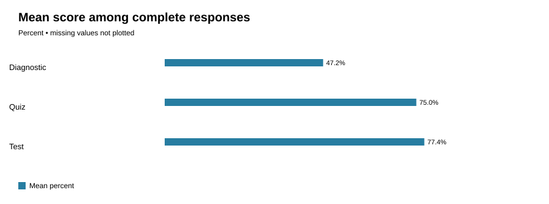

# Teaching objective attainment (anonymized)

Course: Foundations of Mathematics and Pre-calculus 10. Students represented: 6.

## Assessment summary
| Type | Complete n | Partial n | Missing n | Mean % of complete |
|---|---:|---:|---:|---:|
| diagnostic | 6 | 0 | 0 | 47.22 |
| quiz | 6 | 0 | 0 | 75.0 |
| test | 6 | 0 | 0 | 77.38 |

## Objective evidence
| Objective | Assessment | Earned / Possible | Observed % | Students meeting local target |
|---|---|---:|---:|---:|
| O1: Identify solution of a linear system | diagnostic | 8.0/12.0 | 66.67 | 3/6 |
| O1: Identify solution of a linear system | quiz | 10.0/12.0 | 83.33 | 4/6 |
| O1: Identify solution of a linear system | test | 15.0/18.0 | 83.33 | 3/6 |
| O2: Solve systems using substitution or elimination | diagnostic | 6.0/12.0 | 50.0 | 1/6 |
| O2: Solve systems using substitution or elimination | quiz | 18.0/24.0 | 75.0 | 4/6 |
| O2: Solve systems using substitution or elimination | test | 23.0/30.0 | 76.67 | 4/6 |
| O3: Interpret a solution in context | diagnostic | 3.0/12.0 | 25.0 | 0/6 |
| O3: Interpret a solution in context | quiz | 17.0/24.0 | 70.83 | 4/6 |
| O3: Interpret a solution in context | test | 27.0/36.0 | 75.0 | 3/6 |

**Pre/post growth: NOT COMPARABLE.** Not calculated: different pre/post items, constructs or scales may not be equivalent. Comparable anchor design and matched cohort validation required.

Thresholds shown are teacher-defined planning indicators, not BC provincial letter-grade cutoffs. Diagnostic questions sample prerequisites; post-tests sample taught objectives; raw percentages are not equivalent constructs.

## Teaching interpretation
Review lower-attainment objectives, inspect item distractors and student work, reteach prerequisite misconceptions and collect new aligned evidence. Do not infer causation from these scores alone.

