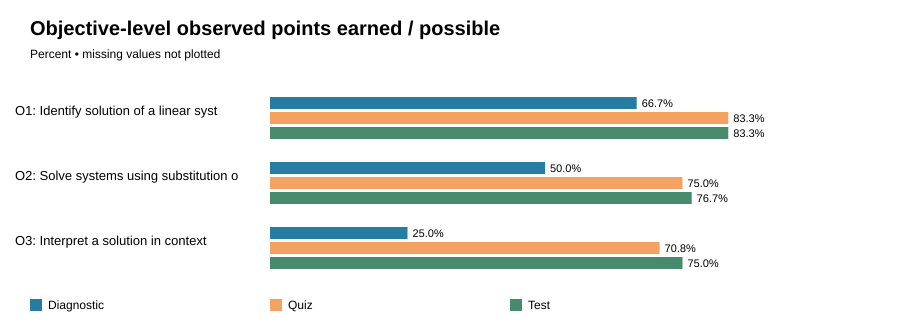
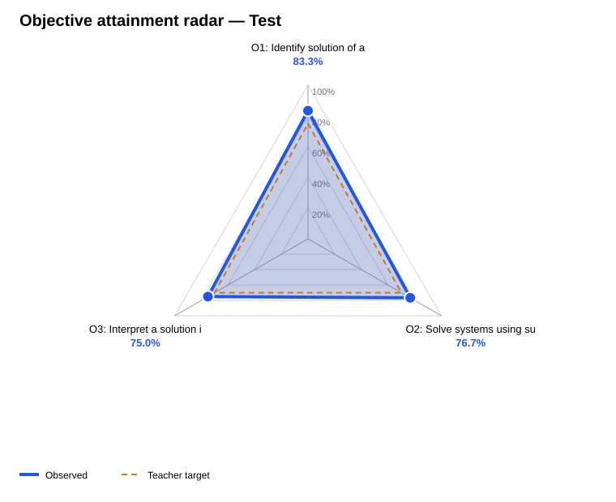

# Teaching objective attainment (anonymized)

Course: Foundations of Mathematics and Pre-calculus 10. Students represented: 6.

## Assessment summary
Scores below use complete responses only; partial and missing responses are counted separately.

| Type | Complete n | Partial n | Missing n | Highest % | Lowest % | Mean % | Median % |
|---|---:|---:|---:|---:|---:|---:|---:|
| diagnostic | 6 | 0 | 0 | 83.33 | 16.67 | 47.22 | 50.0 |
| quiz | 6 | 0 | 0 | 100.0 | 50.0 | 75.0 | 75.0 |
| test | 6 | 0 | 0 | 100.0 | 57.14 | 77.38 | 78.57 |

## Objective evidence
| Objective | Assessment | Earned / Possible | Observed % | Students meeting local target |
|---|---|---:|---:|---:|
| O1: Identify solution of a linear system | diagnostic | 8.0/12.0 | 66.67 | 3/6 |
| O1: Identify solution of a linear system | quiz | 10.0/12.0 | 83.33 | 4/6 |
| O1: Identify solution of a linear system | test | 15.0/18.0 | 83.33 | 3/6 |
| O2: Solve systems using substitution or elimination | diagnostic | 6.0/12.0 | 50.0 | 1/6 |
| O2: Solve systems using substitution or elimination | quiz | 18.0/24.0 | 75.0 | 4/6 |
| O2: Solve systems using substitution or elimination | test | 23.0/30.0 | 76.67 | 4/6 |
| O3: Interpret a solution in context | diagnostic | 3.0/12.0 | 25.0 | 0/6 |
| O3: Interpret a solution in context | quiz | 17.0/24.0 | 70.83 | 4/6 |
| O3: Interpret a solution in context | test | 27.0/36.0 | 75.0 | 3/6 |

[Open the interactive objective radar](objective_radar.html) — choose an assessment and hover or focus each point for exact evidence.

## Teaching recommendations
Recommendations below use the latest available assessment: **test**. They support teacher judgment and do not establish causation.
- Test scores span 57.14%–100.00% (42.86 points). Use flexible grouping: targeted scaffolded practice for students needing support and extension/application tasks for students already secure; confirm needs with item-level work before grouping.
- O1 (Identify solution of a linear system): aggregate attainment is 83.33% against a 75.00% target, but only 3/6 students met it. Keep whole-class instruction moving while providing a targeted small-group check and additional aligned practice for students below target.
- O2 (Solve systems using substitution or elimination): aggregate attainment is 76.67% against a 70.00% target, but only 4/6 students met it. Keep whole-class instruction moving while providing a targeted small-group check and additional aligned practice for students below target.
- O3 (Interpret a solution in context): aggregate attainment is 75.00% against a 70.00% target, but only 3/6 students met it. Keep whole-class instruction moving while providing a targeted small-group check and additional aligned practice for students below target.

**Pre/post growth: NOT COMPARABLE.** Not calculated: different pre/post items, constructs or scales may not be equivalent. Comparable anchor design and matched cohort validation required.

Thresholds shown are teacher-defined planning indicators, not BC provincial letter-grade cutoffs. Diagnostic questions sample prerequisites; post-tests sample taught objectives; raw percentages are not equivalent constructs.

